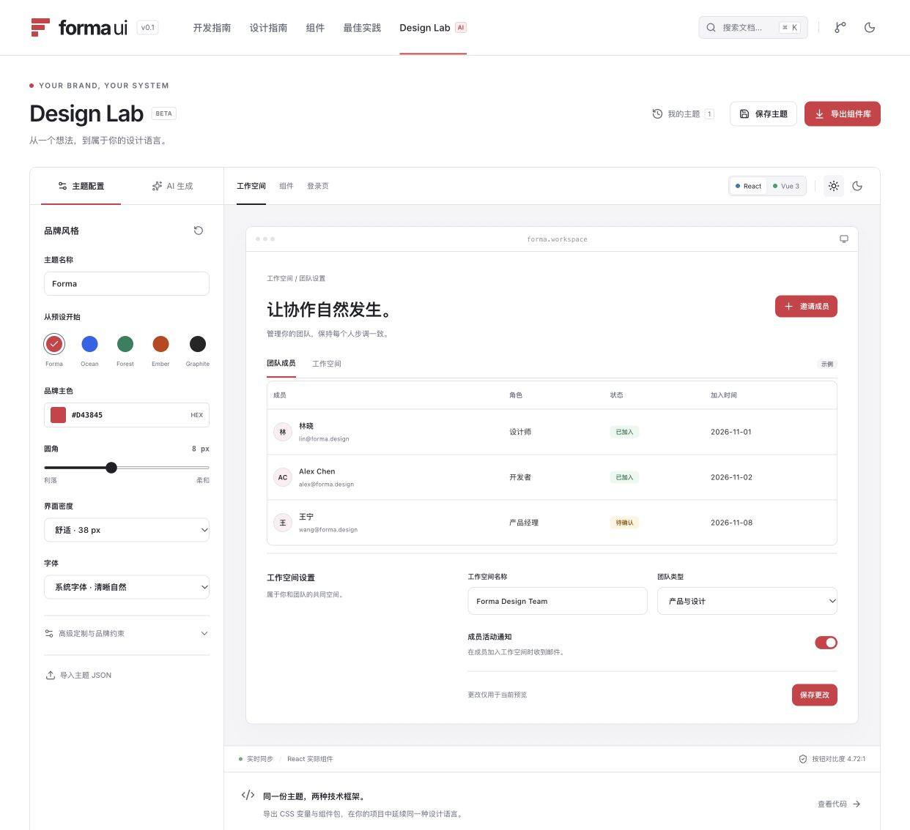

# Forma UI

面向系统前后台的设计系统与组件库，包含 React / Vue 3 组件、共用主题引擎、中文文档站和 Design Lab。

源码仓库：[BTBON9090/btdesign-system](https://github.com/BTBON9090/btdesign-system)。当前为 **v0.1 基础版本**：可以运行、定制、导出并接入项目；还不是 Ant Design 等成熟企业组件库的完整功能替代品。个人网站部署地址尚未确定，本仓库不预设域名。



## 已实现

- **16 类组件、两个框架实现**：Button、Input、Textarea、Select、Checkbox、Switch、Badge、Card、Alert、Tabs、Dialog、Avatar、Separator、Table、Skeleton、Progress。
- **三层主题**：品牌主色 / 圆角 / 密度 / 字体；深浅色语义变量；按钮、输入框、卡片的局部几何配置。
- **Design Lab**：React / Vue 实时预览、深浅色切换、主题预设、品牌字段锁定、本地保存、JSON 导入、主题 CSS 与组件安装包 ZIP 导出。
- **DeepSeek 接入**：服务端生成主题建议，预览后应用；密钥只留在服务端。未设置密钥时明确显示不可用。
- **文档站**：开发指南、设计指南、组件示例与 API、最佳实践、渐进迁移指南。
- **迁移审计 CLI**：读取已有项目并生成第三方组件用法清单与候选映射，不修改业务源码。

品牌锁定约束的是主题编辑流程，不能阻止业务代码直接覆盖 CSS。主题草稿保存在当前浏览器，尚无企业账户、多人同步、租户权限或远程主题版本服务。AI 生成现有组件的主题配置，不生成任意新组件源码。Table / Select 目前为原生语义基础组件，没有高级表格、表单引擎、树、日期选择器或虚拟滚动。

## 本地运行

需要 Node.js **22.12 或更高版本**与 npm。仓库使用 npm workspaces。

```sh
git clone https://github.com/BTBON9090/btdesign-system.git
cd btdesign-system
npm ci
npm run dev
```

文档站默认在 `http://127.0.0.1:5173`，AI API 在 `http://127.0.0.1:8787`。开发命令会先构建组件包并生成可下载安装包，再同时启动文档站与 API。编辑组件包源码后需要重新构建对应包；文档站源码由 Vite 热更新。

AI 功能可选。需要启用时：

```sh
cp .env.example .env
# 在 .env 中填写 DEEPSEEK_API_KEY，然后重启开发服务。
```

默认使用 DeepSeek `deepseek-flash`，可通过服务端 `AI_MODEL` 和 `AI_BASE_URL` 覆盖。生产环境同时要求 `LAB_API_TOKEN`。该令牌用于访问 Design Lab API，与模型密钥不同。详见 [AI 接入说明](docs/ai-api.md)。

## 在已有项目中使用

当前提供源码与本地 `.tgz` 包，**尚未发布到 npm 公共注册表**。先在此仓库生成安装包：

```sh
npm run pack:libs
```

产物位于 `apps/docs/public/downloads/`。将 tokens 包与对应框架包复制到目标项目，使用实际路径安装：

```sh
# React 项目已有同版本 react / react-dom，目标 React 18 或 19
npm install ./forma-ui-tokens-0.1.0.tgz ./forma-ui-react-0.1.0.tgz

# Vue 项目已有 vue，支持 Vue 3.4+、低于 4
npm install ./forma-ui-tokens-0.1.0.tgz ./forma-ui-vue-0.1.0.tgz
```

包提供 ESM JavaScript 与 TypeScript 声明，组件包依赖同版本 tokens。使用方需要支持 CSS 导入的构建工具。React 示例：

```tsx
import { Button, Card } from '@forma-ui/react';
import '@forma-ui/tokens/styles.css';

export default function App() {
  return (
    <Card>
      <h2>团队工作空间</h2>
      <Button onClick={() => console.log('开始构建')}>开始构建</Button>
    </Card>
  );
}
```

Vue 示例：

```vue
<script setup lang="ts">
import { Button, Card } from '@forma-ui/vue';
import '@forma-ui/tokens/styles.css';
</script>

<template>
  <Card>
    <h2>团队工作空间</h2>
    <Button>开始构建</Button>
  </Card>
</template>
```

从 Design Lab 导出 `theme.css` 后，在基础样式之后追加 `import './theme.css'`。导出主题包含深浅两套变量，可通过 `document.documentElement.dataset.theme = 'dark'` 切换；浅色值为 `'light'`。动态局部预览使用 `createTheme(theme, mode)`，详见 [主题契约](docs/theme-contract.md)。

## 命令与项目结构

| 命令                                                                     | 用途                                                   |
| ------------------------------------------------------------------------ | ------------------------------------------------------ |
| `npm run dev`                                                            | 构建组件与安装包，启动文档站和本地 API                 |
| `npm run build`                                                          | 构建全部包、API、下载包与文档站                        |
| `npm test`                                                               | 运行主题、组件、API 与迁移审计测试                     |
| `npm run typecheck`                                                      | 构建组件并检查文档站类型                               |
| `npm run pack:libs`                                                      | 生成三个本地组件安装包                                 |
| `npm run migrate:audit -- /path/to/app --framework react --out ./report` | 只读审计并写入新的报告目录；Vue 使用 `--framework vue` |

```text
packages/tokens/     主题结构、生成逻辑、共享组件 CSS
packages/react/      React 组件与类型
packages/vue/        Vue 3 组件与类型
apps/docs/           Vite 文档站与 Design Lab
apps/api/            DeepSeek API 核心、本地 Node 服务与测试
api/                 Vercel 函数入口
scripts/             开发启动、打包、迁移审计
docs/                架构、主题、兼容性、AI 与部署文档
```

## 构建与发布

```sh
npm test
npm run build
```

静态网站产物为 `apps/docs/dist/`；Node API 产物为 `apps/api/dist/`。可将仓库根目录导入 Vercel，使用随仓库提供的 `vercel.json`；也可把静态网站部署在个人网站的子目录，并通过同源反向代理接入 API。

例如部署至 `/design-system/`：

```sh
BASE_PATH=/design-system/ VITE_API_BASE_URL=/design-system/api npm run build
```

`BASE_PATH` 和 `VITE_API_BASE_URL` 是构建环境变量，后者是包含 `/api` 的接口前缀。静态托管不会自动提供 AI 服务。部署前阅读 [部署指南](docs/deployment.md)；GitHub Actions 仅检查代码，不会自动发布网站或 npm 包。

## 设计与工程文档

- [底层架构与扩展方式](docs/architecture.md)
- [主题格式、覆盖优先级与品牌约束](docs/theme-contract.md)
- [框架、浏览器与组件支持边界](docs/compatibility.md)
- [现有系统迁移](docs/migration.md)
- [DeepSeek 接入与错误处理](docs/ai-api.md)
- [部署到个人网站](docs/deployment.md)
- [构建、浏览器与安装包验证记录](docs/verification.md)

自动检查覆盖代表性组件语义、主题计算、API 校验与迁移工具行为。它们不等同于完整浏览器矩阵、辅助技术认证或真实企业业务验收。接入项目后仍需测试自己的数据、交互、品牌覆盖和目标设备。

本仓库原创代码采用 [MIT License](LICENSE)。第三方依赖及字体保留各自许可。
